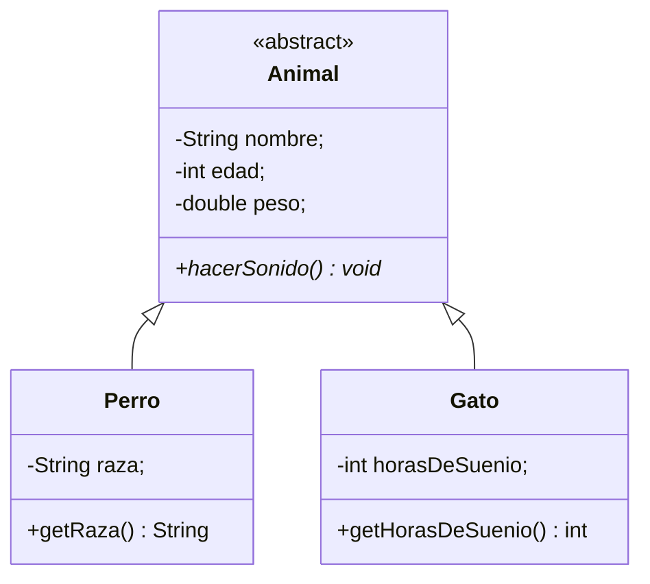

# 🐾 Herencia sin testamento: Cómo funciona POO en Java

**Taller UNAHUR-TICs 2026** · Universidad Nacional de Hurlingham

Junto a mi compañera Silvina Yañez creamos este taller, el cual principalmente es para que aprendas Programación Orientada a Objetos. No importa si no entendés mucho del lenguaje o si sos principiante en programación: lo que vamos a aprender es pensamiento de objetos.

> No se trata de memorizar sintaxis: se trata de aprender a **pensar en objetos**.

---

## 🎯 ¿De qué trata el taller?

Un recorrido por los conceptos fundamentales de la POO usando Java:

1. **Historia:** del código secuencial (código espagueti) a la programación estructurada y, finalmente, a los objetos. La Crisis del Software (1968).
2. **¿Por qué Java?** En Java todo vive dentro de una clase, y es un buen entorno para aprender buenas prácticas.
3. **Clases y objetos:** la clase es el molde; los objetos son las instancias concretas.
4. **Los cuatro pilares:** abstracción, encapsulamiento, herencia y polimorfismo, aplicados a una jerarquía de animales.
5. **Práctica guiada:** agregar un animal propio al proyecto.

## 👥 ¿A quién está dirigido?

- A todos los que tengan ganas de aprender sobre el tema. Sin limitaciones.

---

## 🗂️ Estructura del proyecto

```
Taller-UNAHURTICs-Animales-2026/
├── Animal.java    # Superclase abstracta (atributos comunes + método abstracto)
├── Perro.java     # Subclase: agrega `raza`, sonido "Guau"
├── Gato.java      # Subclase: agrega `horasDeSuenio`, sonido "Miau"
├── Main.java      # Punto de entrada: instancia objetos y prueba el polimorfismo
└── README.md
```

## 🧩 Diagrama de clases



---

## 🏛️ Los cuatro pilares en el código

| Pilar | Qué es | Dónde aparece |
| --- | --- | --- |
| **Abstracción** | Quedarse solo con lo esencial para el problema | `Animal` con `nombre`, `edad`, `peso` y `hacerSonido()` |
| **Encapsulamiento** | Proteger el estado interno y exponer una interfaz controlada | Atributos `private` + getters y setters públicos |
| **Herencia** | Crear clases a partir de otras, reutilizando lo común (relación ES-UN) | `extends` y `super(...)` en `Perro` y `Gato` |
| **Polimorfismo** | Objetos distintos responden al mismo mensaje, cada uno a su manera | `hacerSonido()` abstracto en `Animal` y `@Override` en cada subclase |

### Fragmentos clave

**Encapsulamiento:** atributos privados, métodos públicos.

```java
private String nombre;

public String getNombre() {
    return this.nombre;
}

public void setNombre(String nuevoNombre) {
    this.nombre = nuevoNombre;
}
```

**Herencia:** la subclase inicializa la parte heredada con `super(...)`, siempre en la primera línea.

```java
public class Perro extends Animal {
    private String raza;

    public Perro(String nombre, int edad, double peso, String raza) {
        super(nombre, edad, peso);
        this.raza = raza;
    }
}
```

**Polimorfismo:** misma orden, distinta respuesta.

```java
// en Animal
public abstract void hacerSonido();

// en Perro
@Override
public void hacerSonido() {
    System.out.println("Guau");
}
```

**Uso desde `Main`:**

```java
Animal coraje = new Perro("Coraje", 3, 43.0, "Golden");
Animal cuki = new Gato("Cuki", 8, 5.0, 16);

coraje.hacerSonido();
cuki.hacerSonido();
```

---

## ▶️ Cómo ejecutarlo

### Opción 1: en un entorno online

Copiá los cuatro archivos `.java` en un IDE online de Java (el que se usó en el taller -OneCompiler-) y apretá el botón **Run** o **Correr**.

### Opción 2: en tu computadora

**Requisitos:** tener instalado el [JDK](https://adoptium.net/) (Java 8 o superior).

```bash
# 1. Clonar el repositorio
git clone https://github.com/MariaMilagrosCarucci/Taller-UNAHURTICs-Animales-2026.git
cd Taller-UNAHURTICs-Animales-2026

# 2. Compilar
javac *.java

# 3. Ejecutar
java Main
```

## 🖥️ Salida esperada

```
Guau
Miau
```

Ambos objetos reciben el mismo mensaje (`hacerSonido()`), pero cada uno ejecuta su propio comportamiento. Eso es el polimorfismo.

---

## ✍️ Práctica: ahora es tu turno

**Consigna:** agregá un animal de tu elección y creá un objeto con sus valores.

1. **Elegí el animal y comprobá la regla ES-UN.** La frase "Un ___ ES-UN Animal" tiene que tener sentido.
2. **Creá la clase.** `public class NombreDelAnimal extends Animal { }`
3. **Agregá un atributo propio.** Declaralo `private` y elegí algo que distinga a tu animal (por ejemplo, `sabeNadar` para un pato).
4. **Escribí el constructor.** Recibe `nombre`, `edad`, `peso` y tu atributo. La primera línea es `super(nombre, edad, peso);` y después asignás tu atributo con `this`.
5. **Agregá el getter y el setter** de tu atributo (por ejemplo, `getSabeNadar` y `setSabeNadar`).
6. **Definí su sonido.** Redefiní `hacerSonido()` con `@Override` y hacé que imprima el sonido de tu animal.
7. **Creá el objeto.** En `Main.java`: `Animal nombre = new NombreDelAnimal(...);` y llamá a su `hacerSonido()`.
8. **Ejecutá y verificá.** Apretando el botón **Run** o **Correr**.

<details>
<summary>💡 Ejemplo resuelto: un pato (abrir solo después de intentarlo)</summary>

```java
public class Pato extends Animal {
    //atributo sólo de Pato
    private boolean sabeNadar;

    //constructor
    public Pato(String nombre, int edad, double peso, boolean sabeNadar) {
        super(nombre, edad, peso);
        this.sabeNadar = sabeNadar;
    }

    //getter
    public boolean getSabeNadar() {
        return this.sabeNadar;
    }

    //setter
    public void setSabeNadar(boolean nuevoValor) {
        this.sabeNadar = nuevoValor;
    }

    @Override
    public void hacerSonido() {
        System.out.println("Cuac");
    }
}
```

En `Main.java`:

```java
Animal pipo = new Pato("Pipo", 2, 3.5, true);
pipo.hacerSonido();   // imprime: Cuac
```

Fijate que para agregar el pato **no hizo falta tocar** `Animal`, `Perro` ni `Gato`: solo se agregó código nuevo.

</details>

---

> **Regla de oro:** atributos privados, métodos públicos.

---

## 👩‍💻 Autoras

**María Milagros Carucci**
Estudiante de la Licenciatura en Informática · Universidad Nacional de Hurlingham (UNAHUR)

**Miria Silvina Yañez**
Estudiante de la Licenciatura en Informática · Universidad Nacional de Hurlingham (UNAHUR)

Taller presentado en **UNAHUR-TICs 2026**.